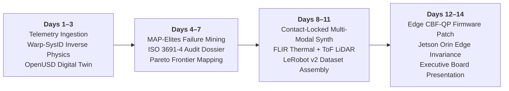

# STATEMENT OF WORK & PILOT AGREEMENT
## Turnkey Physical AI Safety Certification & Multi-Modal Synthetic Data Pilot

**Document Reference:** `DIFFRACTION-SOW-PILOT-2026`  
**Agreement Date:** `[Date]`  
**Between:**  
* **Provider:** Diffraction Autonomous Systems Inc. ("Diffraction")  
* **Customer:** `[Customer Robotics OEM / Enterprise Logistics Operator]` ("Customer")  

---

### 1. Executive Summary & Purpose
Autonomous robot site commissioning currently requires **6 to 8 weeks of manual engineering per customer facility**, costing between **\$150,000 and \$400,000** in delayed deployment revenue, site modification disputes, and safety compliance liability. Floor friction variations (dry concrete $\mu \approx 0.70$ vs. wet washdown/oily epoxy $\mu \approx 0.22$), ambient lighting drops, sensor latency jitter, and generative contact hallucinations present severe existential risks to commercial robotics deployments.

This 14-Day Pilot Project deploys Diffraction's proprietary deep-tech verification engine to ingest Customer's edge robot telemetry, solve continuous-time inverse physics, map high-dimensional failure frontiers, execute formal ISO 3691-4 / ANSI R15.08 safety audits, synthesize contact-locked multi-modal training data, and export certified real-time edge safety governors.

---

### 2. 14-Day Turnkey Pilot Execution Timeline

| Phase & Milestone | Business Days | Diffraction Proprietary Deliverables |
| :--- | :--- | :--- |
| **Milestone 1: Telemetry & Differentiable SysID** | Days 1–3 | • Ingest Customer's raw `.mcap` / ROS 2 bag incident or operational telemetry. • Run **Warp-SysID**: continuous-time differentiable RK4 unrolled gradient descent recovering exact floor kinetic friction ($\mu_k$), static threshold ($\mu_s$), actuator latency ($\tau_{\text{act}}$), and mass variance ($R^2 > 0.99$). • Synthesize calibrated 3D **OpenUSD digital twin scene** (`.usda`). |
| **Milestone 2: Adversarial Failure Search & ISO Audit** | Days 4–7 | • Execute **MAP-Elites Quality-Diversity Search** over 4D behavioral archive ($\mu \times \text{Glare} \times \text{Latency} \times \text{Mass}$). • Extract exact Pareto failure frontier and safe operational speed envelope ($\mu_{\min}$, $v_{\max}$, glare ceiling). • Issue formal **ISO 3691-4:2023** & **ANSI/RIA R15.08 Part 2** Safety Audit Dossier (`.html` and `.json`) with legal liability sign-off. |
| **Milestone 3: Contact-Locked Multi-Modal Synthetic Data** | Days 8–11 | • Generate **0.000 px drift contact-locked synthetic dataset** eliminating generative video hallucinations. • Synthesize synchronized **FLIR LWIR thermal** ($8-14\,\mu\text{m}$ Stefan-Boltzmann calibrated in Kelvin), **ToF LiDAR depth & intensity**, and optical spectra (Sodium 589nm, NVG P43 Green). • Package dataset into Hugging Face **LeRobot v2** format (`meta/info.json`, `meta/stats.json`) for immediate policy fine-tuning. |
| **Milestone 4: Edge CBF-QP Shield & Executive Handover** | Days 12–14 | • Deploy real-time **CBF-QP Safety Governor** executing in $< 0.15\text{ ms}$ ($\ge 500\text{ Hz}$) on NVIDIA Jetson Orin edge compute. • Provide ROS 2 Nav2 Costmap Speed Filter Mask (`.yaml`) and controller tuning patch. • Package complete, self-contained **Pilot ZIP Dossier** and deliver executive presentation to Customer VP of Engineering & Autonomy Director. |

---

### 3. Concrete Deliverable Assets (Customer Ownership)
At the conclusion of the 14-day engagement, Customer receives a self-contained handoff bundle containing:
1. `00_input_telemetry/`: Validated telemetry containers and trajectory decoders.
2. `01_certification_and_audit/`: Interactive HTML & machine-readable JSON ISO 3691-4 / ANSI R15.08 compliance certificate.
3. `02_spatial_digital_twin/`: Explicit 3D polygonal OpenUSD scene (`.usda`) replicating Customer's facility failure site.
4. `03_physics_calibration/`: Warp-SysID parameter recovery dataset ($\mu_k$, $\mu_s$, $\tau_{\text{act}}$, $R^2$).
5. `04_adversarial_failure_frontier/`: MAP-Elites Pareto boundary points (`.csv`) and safe operational envelope.
6. `05_multimodal_dataset/`: Contact-locked multi-modal training dataset in Hugging Face LeRobot v2 format with radiometric FLIR thermal and LiDAR depth maps.
7. `06_edge_cbf_qp_governor/`: Real-time Python/C++ active-set Control Barrier Function solver, Nav2 costmap filter mask, and 1-click deployment script (`deploy_edge_governor.sh`).
8. `01_EXECUTIVE_PILOT_DOSSIER.md` & `.html`: Executive summary report for customer C-suite and safety compliance committee.

---

### 4. Pricing & Commercial Terms

* **Fixed Pilot Engagement Fee:** **\$25,000 USD** (flat fee for 1 robot embodiment at 1 customer facility).
* **100% Credit Toward Annual Enterprise License:** 100% of the \$25,000 pilot fee is credited towards Customer's first-year Diffraction Annual Enterprise License (\$65,000–\$180,000/year depending on fleet volume) if executed within 60 days of pilot completion.
* **Payment Schedule:**
  * **50% (\$12,500 USD)** invoiced upon contract execution (commencement of Milestone 1).
  * **50% (\$12,500 USD)** invoiced upon final delivery of the complete Pilot Package and Executive Dossier (completion of Milestone 4).
* **Payment Terms:** Net 15 days from invoice date.

---

### 5. Intellectual Property & Security Safeguards

1. **Customer Hardware & Policy Confidentiality:** Customer retains 100% sole ownership of all robot designs, CAD/URDF files, neural policy weights (VLA, RL, classical planners), site telemetry logs, and facility floorplans.
2. **Diffraction IP Protection:** Diffraction retains proprietary ownership of its core underlying algorithms, including Warp-SysID, CBF-QP edge solver, MAP-Elites search heuristics, and Contact-Locked Diffusion manifolds.
3. **Data Isolation & Air-Gap Compliance:** All telemetry and simulation artifacts are stored in an isolated, SOC2-compliant single-tenant container and may be deployed entirely air-gapped within Customer's private AWS/GCP VPC or on-prem DGX compute cluster.

---

### 6. Signatures & Acceptance

IN WITNESS WHEREOF, the parties hereto have executed this Statement of Work as of the date first written above.

**Diffraction Autonomous Systems Inc.**  
Signature: _________________________________________  
Name: ____________________________________________  
Title: Founder & Chief Technology Officer  
Date: ____________________________________________  

**Customer: [Customer Company Name]**  
Signature: _________________________________________  
Name: ____________________________________________  
Title: VP of Autonomy / VP of Engineering  
Date: ____________________________________________  
