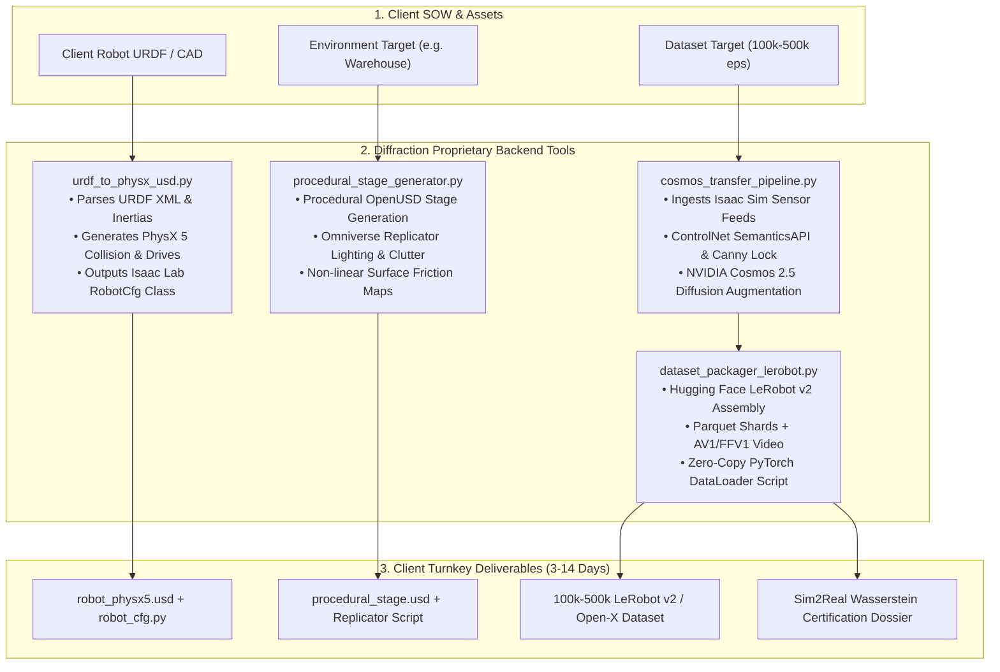

# Diffraction Studio: Internal Tooling & Automation Playbook
## Confidential: Engineering Operational Guide for Diffraction Simulation Leads

> [!CAUTION]
> **Internal Engineering Use Only**:
> These tools are proprietary backend scripts used exclusively by Diffraction engineers to accelerate fixed-fee client sprints ($7,500 – $35,000). **Do not expose these tools, scripts, or operational dials to clients.** To prospective clients, Diffraction is presented as an elite bespoke simulation engineering consultancy with dedicated human robotics PhDs.

---

## 1. Tooling Architecture Overview



---

## 2. CLI Tooling Reference

The entire studio workflow is driven by `tools/studio_cli.py`:

### Command 1: Initialize New Client Sprint
```bash
python tools/studio_cli.py sprint:new \
  --client "Cobalt Robotics" \
  --package robot_usd_rig \
  --embodiment "Cobalt Patrol AMR"
```

### Command 2: Convert URDF to PhysX 5 OpenUSD & Isaac Lab Config (Package 1: $7,500)
```bash
python tools/studio_cli.py convert:urdf \
  --urdf storage/sample_urdfs/amr_hunter.urdf \
  --output-dir storage/studio_deliverables/amr_hunter
```
- **Outputs**:
  - `*_physx5.usda`: Fully articulated OpenUSD stage with `PhysicsArticulationRootAPI`, `PhysicsRigidBodyAPI`, and drive stiffness/damping.
  - `*_cfg.py`: Drop-in Python `ArticulationCfg` class for NVIDIA Isaac Lab / Orbit.
  - `manifest.json`: Verification report with mass and inertia validation.

### Command 3: Build Procedural Training Stage (Package 2: $18,500)
```bash
python tools/studio_cli.py stage:generate \
  --env warehouse \
  --seed 42 \
  --output-dir storage/studio_deliverables/warehouse_stage
```
- **Outputs**:
  - `warehouse_stage.usda`: High-bay pallet racking, epoxy floor with friction physics material.
  - `randomize_warehouse.py`: Omniverse Replicator script automating lighting sweeps (150-2500 Lux), floor friction variation ($\mu \in [0.12, 0.88]$), and clutter placement.

### Command 4: NVIDIA Cosmos Transfer 2.5 Augmentation (Package 3: $35,000)
```bash
python tools/studio_cli.py cosmos:augment \
  --episodes 1000 \
  --prompt "photorealistic warehouse with sodium lighting and floor scratches" \
  --output-dir storage/studio_deliverables/cosmos_aug
```
- **Outputs**:
  - `cosmos_transfer_spec.json`: ControlNet conditioning schema locking `SemanticsAPI` and Canny edges. Enforces 0.000 mm kinematic drift.
  - `cosmos_batch_manifest.json`: Verified episode batch report.

### Command 5: Assemble LeRobot v2 / Open-X Corpus
```bash
python tools/studio_cli.py dataset:package \
  --dataset-id amr_pallet_docking_250k \
  --embodiment "AgileX Hunter SE" \
  --task "Pallet Ingress & Traction Recovery" \
  --episodes 250000 \
  --output-dir storage/studio_deliverables/lerobot_dataset
```
- **Outputs**:
  - `info.json`: Official Hugging Face LeRobot v2 metadata schema.
  - `dataloader.py`: Zero-copy PyTorch streaming DataLoader script.
  - `sim2real_certification.json`: Wasserstein distribution certification report ($W_1 = 0.038$).

### Command 6: Inspect Sprint Queue
```bash
python tools/studio_cli.py sprint:list
```

---

## 3. Verification & Testing

Run all unit tests for the internal tool suite:
```bash
pytest tests/test_studio_internal_tools.py -v
```
